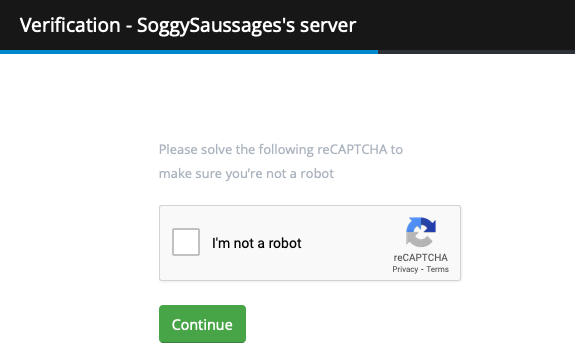
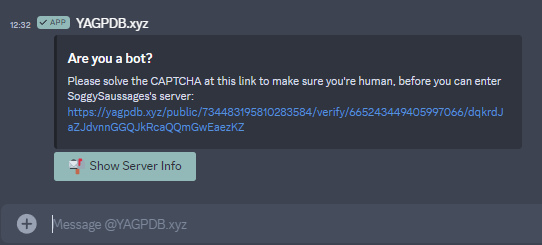

+++
title = "Verification"
weight = 450
description = "Google reCAPTCHA v2 verification for new members."
+++

Use Google reCAPTCHA v2 to verify your members before permitting them access to your server.

The verification plugin assigns a specified role to new members after they successfully complete Google reCAPTCHA v2 verification.
This allows you to further verify new members as humans rather than bots before granting them access to your server.

This is accomplished by sending new members a customizable DM (which employs [template scripting](/docs/reference/templates)) containing a unique link to verify, tied to their User ID.
This link takes them to a customizable verification page with a CAPTCHA challenge.
Once completed, the User ID is assigned the verified role.



You must assign a "Verified Role" on the Verification page in the control panel.
The plugin will not function if no role is selected.



## Verify Page

The verification page uses markdown format to render the page.
The CAPTCHA challenge and confirmation button are suffixed below the page content.
A success message is displayed upon CAPTCHA completion.
You can customize the page content in the Verification page on the control panel.

## Verification DMs

The verification DM is a template script executed in the new member's DM immediately upon joining.
Text output to the response is sent in the member's DM.

You may optionally send a re-notification message in the member's DMs if they do not verify after X minutes.
This message uses template script as well.

You can customize both messages in the Verification page on the control panel.

[Template Reference](/docs/reference/templates/syntax-and-data)

Verification scripts provide `.Link` as additional dot context data.
This is the unique verification link the user must visit to verify.



If a user has disabled DMs from server members by default, upon joining your server YAGPDB will fail to send a verification DM to the user.
It is recommended that you inform your new members about this possibility and how to fix it if they do not receive a DM from YAGPDB.



## Kick After Unverified

You may optionally configure YAGPDB to kick users who haven't verified after X minutes.
This is configured in the Verification page on the control panel.

## Logs

You may optionally configure a channel to send verification logs to.
This is done on the Verification page in the control panel.

Logged events are:

- New user joined, verification DM sent.
- New user verified.
- New user kicked after being unverified for X minutes (as [configured](#kick-after-unverified)).
- New user verified, alt accounts detected.
- New user banned, detected as alt account of banned user.

The last two only occur when alt detection is enabled, which is only possible on a [selfhosted instance](/selfhosting/plugins/verification).
