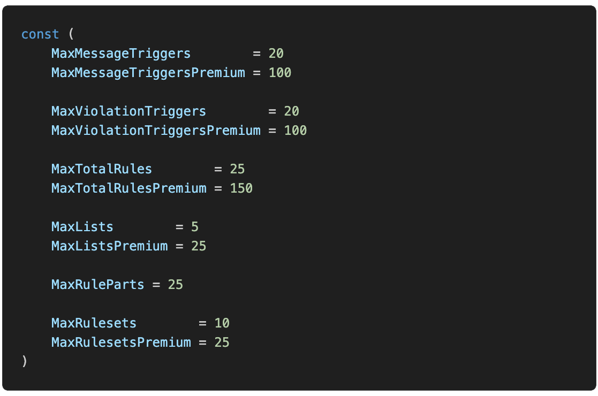

+++
title = "Premium"
description = "Granting premium slots and changing limits on a selfhosted YAGPDB"
weight = 400
+++

On a selfhosted instance you decide who gets [premium](/docs/welcome/premium) and what the limits are.
Both are set up here rather than through the control panel.

## Premium Sources

When hosting YAGPDB yourself, you have access to a few methods to source premium slots to your users.

- Patreon

  1. Configure your price per premium slot in `premium/patreonpremiumsource/patreonpremiumsource.go > func
    CalcSlotsForPledge`.
  2. Configure relevant env variables to connect YAGPDB to your Patreon API.

- Generating premium codes with the `GeneratePremiumCode` command.
- Setting the `premium.all_guilds_premium` env variable to true.

## Changing Limits

Functionally raising or lowering limits, both for premium and non-premium servers, is accomplished by altering the source code.
Most limits are numerical values that only need to be updated in one location.
The [premium page](/docs/welcome/premium) names the relevant key or constant in parentheses for most of its numerical limits.
Ex. (`MaxMessageTriggersPremium`).
It is recommended you familiarize yourself with the codebase before making changes.
Find where these keys or constants are defined and alter their values as you wish.

